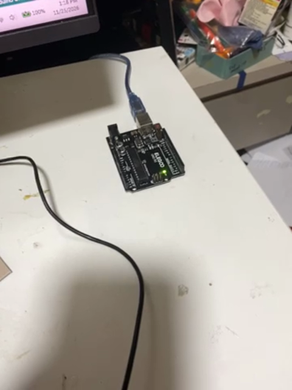

# L02_blink

My first robotics repo: small Arduino Uno sketches, one folder per exercise, building up toward robotics projects.

## Layout

```
L02_blink/
├── README.md
├── L02_blink/
│   ├── L02_blink.ino
│   └── blink-demo.mov
└── images/
```

Arduino requires a sketch's `.ino` file to have the same name as its folder, so `L02_blink/` holds `01_blink.ino`.

## L02_blink

Blinks the Uno's built-in LED once per second.



Demo video: [L02_blink/blink-demo.mov](https://github.com/elltt-dev/ELEGOO_Super-_Starter-_Kit/blob/main/L02_blink/blink-demo.mov)

### Wiring

No external wiring. The only connection is the USB cable between the Uno and the computer, which provides power and carries the upload. The LED is the one on the board labelled **L**, wired internally to digital pin 13 (`LED_BUILTIN`).

### How to run

1. Open `01_blink/01_blink.ino` in the Arduino IDE.
2. Select **Tools → Board → Arduino Uno** and the correct port (mine was COM3).
3. Click **Upload**.

### What I learned

<!-- Fill in with your own notes. Prompts: -->
- What `setup()` and `loop()` each do:
- What `pinMode`, `digitalWrite` and `delay` do:
- What went wrong or surprised me while uploading:
